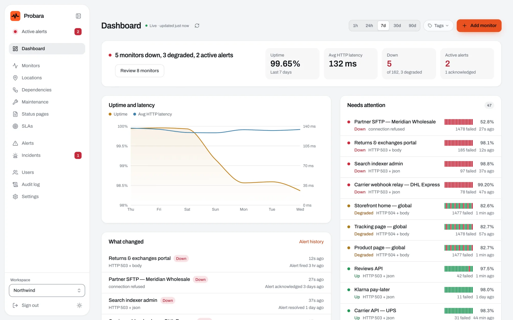
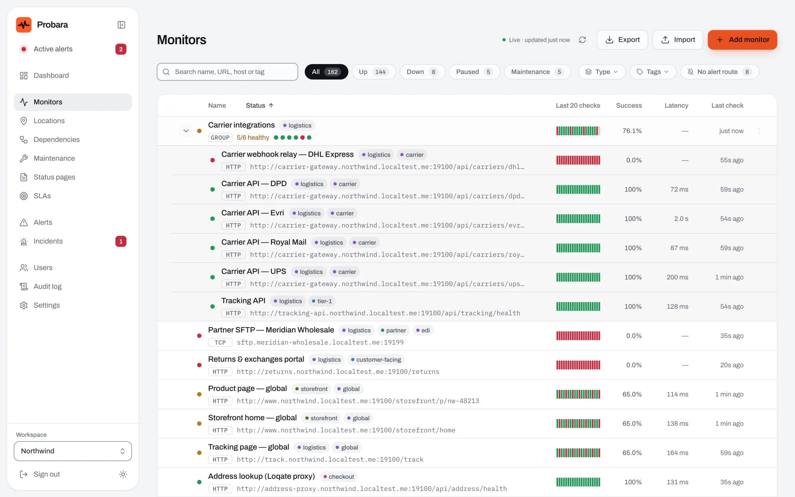
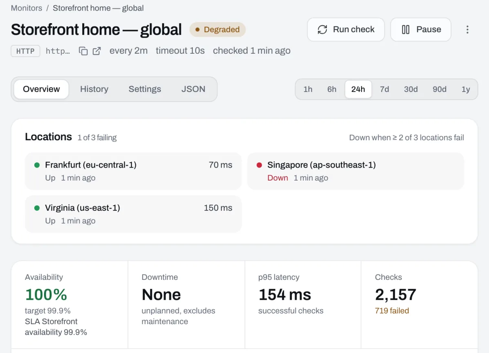
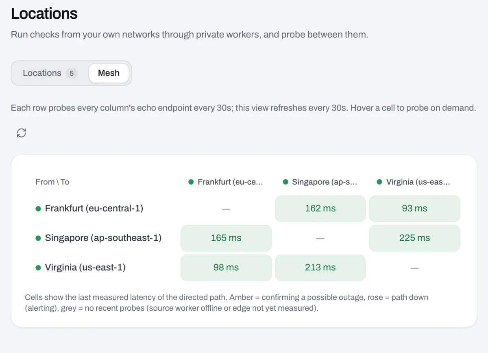
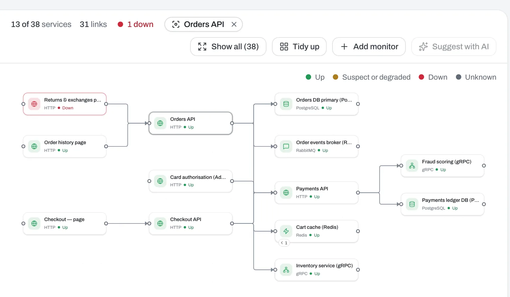
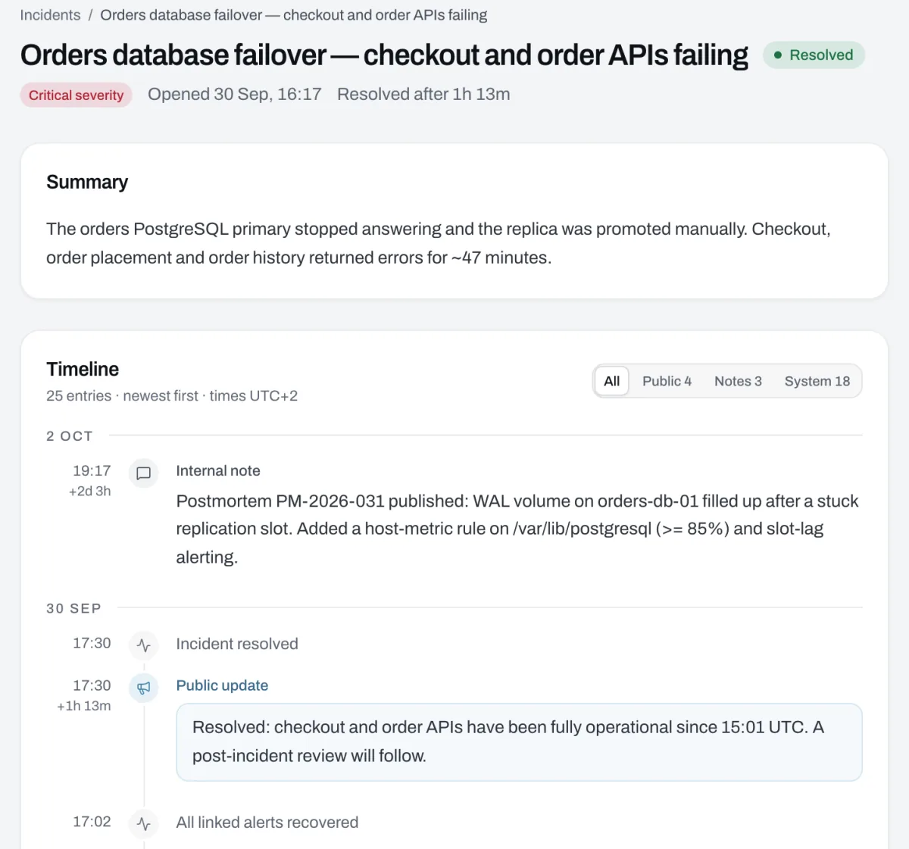
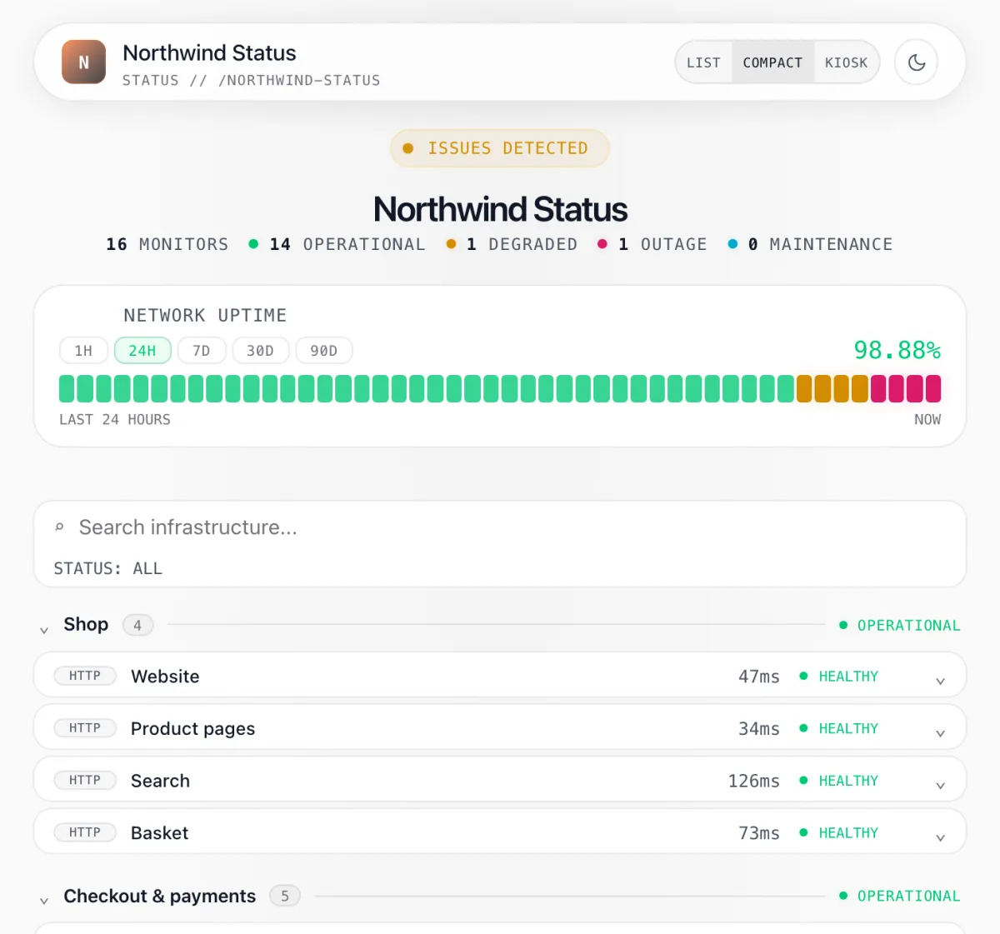
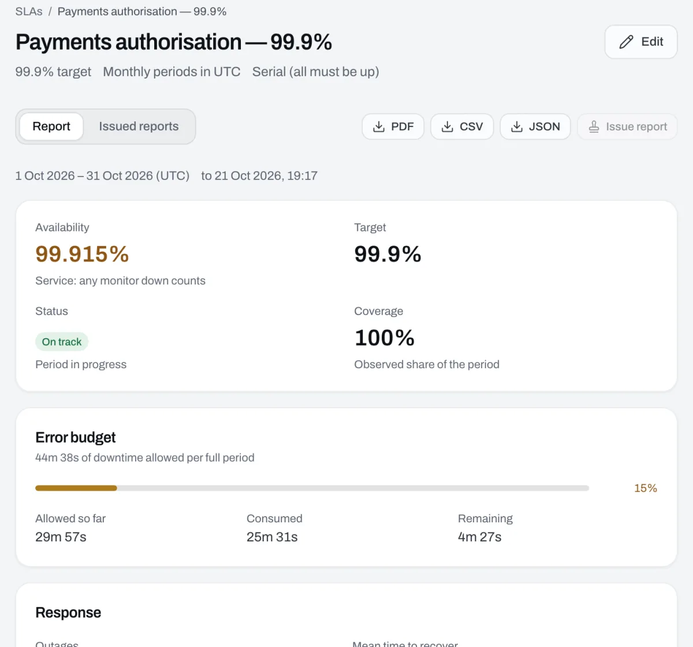
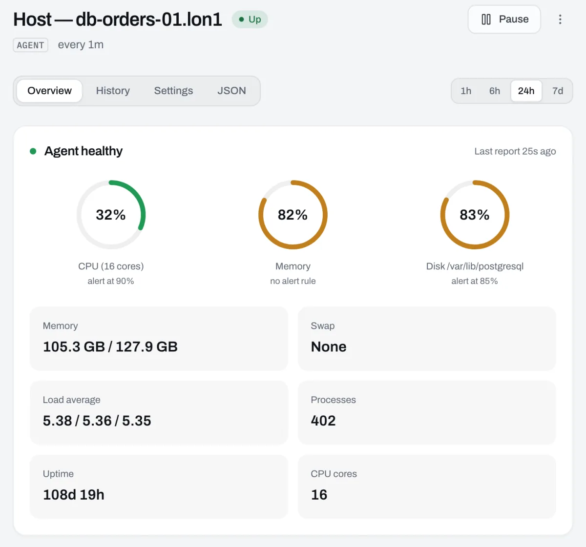
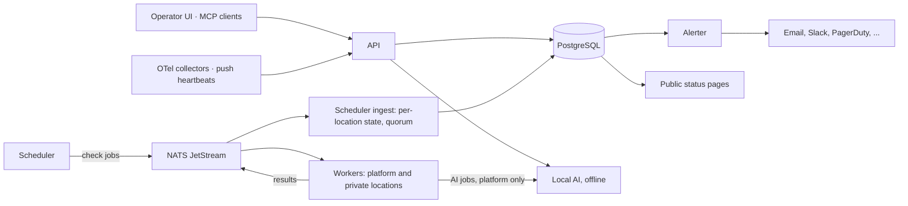

# Probara

**Self-hosted uptime and service monitoring for teams that run their own
infrastructure.** Probara checks web apps, APIs, databases, voice trunks and
hosts from every network you control. Alerting, incidents, status pages and
SLA reports come in the same install.

> **Status:** 2.0 is in alpha ([releases](https://github.com/yassinebenameur/probara/releases)).
> Expect breaking changes between releases.

[Docs](https://probara-uptime.com/docs/getting-started/) ·
[Quick start](#quick-start) ·
[How it compares](#how-it-compares) ·
[Changelog](CHANGELOG.md) · AGPL-3.0

<picture>
  <source media="(prefers-color-scheme: dark)" srcset="docs/screenshots/dashboard-dark.webp">
  
</picture>

## Why Probara

- **Check from every network you own.** Run a worker in a data center, VPC
  or office. Each location keeps its own state. A monitor goes *down* only
  when a quorum of locations fails, and shows *degraded* when fewer do.
  Workers also probe each other, so you see broken paths between sites.
- **More than up/down.** Incidents with public status-page updates,
  maintenance windows, SLA reports with error budgets, and dependency-aware
  alerting that names the likely root cause and can hold back the
  downstream pages.
- **Voice is a first-class check.** Beyond SIP pings, Probara places real
  test calls and can score the audio: packet loss, jitter and an estimated
  MOS.
- **Built for teams.** Workspaces, single sign-on (OIDC), admin/editor/viewer
  roles, an audit log, scoped API keys and optional encryption of stored
  secrets are all in the AGPL release.
- **AI that stays on your hardware.** A bundled CPU model picks a likely
  cause for incidents and, when you turn on automatic triage, for new alerts.
  It also proposes dependency links. There is no LLM provider and no API key,
  and only numeric evidence (counts, timings, flags) reaches it. It never
  delays, routes or suppresses a page; it can optionally post one follow-up
  note to channels that were already paged.
- **Agent-ready.** A built-in MCP server lets Claude Code, Cursor or any MCP
  client operate Probara through the same access checks and audit log as the
  UI. An OAuth connection acts as the signed-in user; an API-key connection
  is limited to that key's scope.

## Tour

### Checks

Probara has 18 monitor types. **Web:** HTTP (status, body, header and JSON
assertions, phase timings, TLS-expiry alerts), multi-step API journeys,
headless-browser journeys, WebSocket and gRPC health. **Network:** ping, DNS,
TCP and SIP. **Data:** Redis, PostgreSQL, MySQL, MongoDB and a message broker
(RabbitMQ). **Other:** host agent (OpenTelemetry), Prometheus query
thresholds, push heartbeats and groups. Checks run every 10 seconds to every
24 hours (SIP test calls at most once a minute).

<picture>
  <source media="(prefers-color-scheme: dark)" srcset="docs/screenshots/monitors-dark.webp">
  
</picture>

Hosts report CPU, memory, disk, load and more over standard OpenTelemetry. A
generated one-line installer sets up `probara-collector` on Linux, macOS or
Windows, or you can point an existing `otelcol-contrib` at Probara. Per-host
metric rules open alerts.

### Locations and mesh

A location worker connects out to NATS, which you expose over TLS with
per-location credentials, and never gets the database or the encryption key.
Workers that join the mesh also expose a small echo port. There is no public
probe network: each vantage point is a worker you run.

<table>
<tr>
<td width="50%">
<picture>
  <source media="(prefers-color-scheme: dark)" srcset="docs/screenshots/multi-location-dark.webp">
  
</picture>
</td>
<td width="50%">
<picture>
  <source media="(prefers-color-scheme: dark)" srcset="docs/screenshots/mesh-dark.webp">
  
</picture>
</td>
</tr>
<tr>
<td><b>Quorum.</b> One of three locations fails, so the monitor is degraded, not down, and its availability holds.</td>
<td><b>Mesh.</b> Workers probe each other in both directions. A broken path alerts for that direction only.</td>
</tr>
</table>

### Alerting and dependencies

There are nine built-in channels: email, Slack, Discord, Microsoft Teams,
Telegram, SMS via Twilio, webhooks (optionally HMAC-signed), PagerDuty and
Opsgenie / Jira Service Management. Acks made in Probara are sent on to
PagerDuty and Opsgenie. Alerts can escalate in tiers, send reminders and stay
quiet during maintenance windows. Latency anomaly detection compares response
times with learned baselines. Every monitor shows whether its alerts reach
anyone.

<picture>
  <source media="(prefers-color-scheme: dark)" srcset="docs/screenshots/dependencies-dark.webp">
  
</picture>

Monitors declare what they depend on. A downstream alert names the deepest
failing upstream as the likely root cause, and optional suppression pages
only that root cause, listing the affected services in the same notification.

### Incidents, status pages and SLAs

Incidents have a severity, an owner, linked alerts and one timeline for both
internal notes and public updates. A separate service renders status pages
that update live in the browser. Pages have sections, published incidents and
maintenance; visitors can switch between list, compact and wall-display kiosk
views and, once you configure push keys, opt in to browser notifications.
Restyle a page with CSS or replace its whole template, with a draft preview
and versioned publish and revert. SLA reports compute availability from each
monitor's state timeline and export as PDF, CSV or JSON.

### More screens

<table>
<tr>
<td width="50%">
<picture>
  <source media="(prefers-color-scheme: dark)" srcset="docs/screenshots/incident-dark.webp">
  
</picture>
</td>
<td width="50%">
<picture>
  <source media="(prefers-color-scheme: dark)" srcset="docs/screenshots/status-page-dark.webp">
  
</picture>
</td>
</tr>
<tr>
<td><b>Incidents.</b> Internal notes and public updates on one timeline.</td>
<td><b>Status page.</b> Services grouped into sections with live health; published incident updates appear here too.</td>
</tr>
<tr>
<td width="50%">
<picture>
  <source media="(prefers-color-scheme: dark)" srcset="docs/screenshots/sla-dark.webp">
  
</picture>
</td>
<td width="50%">
<picture>
  <source media="(prefers-color-scheme: dark)" srcset="docs/screenshots/host-metrics-dark.webp">
  
</picture>
</td>
</tr>
<tr>
<td><b>SLA reports.</b> Availability, coverage and error budget per calendar period, with exports and frozen snapshots.</td>
<td><b>Host metrics.</b> A database server reporting over OpenTelemetry, with alert thresholds on the gauges.</td>
</tr>
</table>

## How it compares

Checked against each project's public repository, docs and pricing pages on
2026-10-21.

| | Probara | Uptime Kuma | Gatus | Better Stack | Checkly |
|---|---|---|---|---|---|
| **Hosting** | Self-hosted, AGPL-3.0 | Self-hosted, MIT | Self-hosted, Apache-2.0 | SaaS, free tier + paid | SaaS, free tier + metered |
| **Web & API** | HTTP, API journeys, browser | HTTP, browser | HTTP, API suites | HTTP, API, Playwright | HTTP, API, Playwright |
| **Network** | Ping, DNS, TCP, gRPC, WebSocket | Ping, DNS, port, gRPC, more | ICMP, DNS, TCP/UDP/SCTP, gRPC, TLS | Ping, DNS, port, SSL | ICMP, DNS, TCP, gRPC |
| **Databases** | Postgres, MySQL, Mongo, Redis, RabbitMQ | More, incl. SQL Server, Kafka | No | No | No |
| **Voice / SIP** | Pings, register, test calls, audio | Pings (2.1+) | No | No | No |
| **Vantage points** | Your workers, quorum, mesh | Its host + Globalping probes | Its host | 4+ public regions by default | 6–22 public; private on Team+ |
| **Users** | Workspaces, SSO, roles, audit | Single user | Basic-auth or OIDC, no roles | Team accounts | Team accounts |
| **Incidents & SLAs** | Incidents, status pages, SLA reports | Status pages, banners | Status page, announcements | Incidents, on-call, status pages | Status pages, incidents |
| **AI** | Offline, on your CPUs | No | No | Hosted LLM, per token | Root-cause analysis, capped |
| **MCP server** | Built in | No | No | Yes | Yes |

**Where the alternatives are stronger**

- **Global reach out of the box.** The SaaS tools check from public regions
  with nothing to deploy. Probara checks only from where you run a worker.
- **Footprint and breadth.** Uptime Kuma is a single Node.js process. It
  covers more protocols (SQL Server, Oracle, MQTT, Kafka, SNMP, SMTP, NTP and
  others) and links to 90+ notification services, where Probara has 9
  channels. Gatus is one binary configured in YAML. A default Probara Helm
  install requests about 2 CPU and 3.4 Gi with local AI, or about 1 CPU and
  1.4 Gi without it.
- **On-call and status-page extras.** Better Stack includes on-call
  scheduling and phone alerts; Probara hands paging to PagerDuty or Opsgenie.
  Probara has no per-page custom domains (serve it behind your own domain or
  reverse proxy), no password-protected pages and no email subscribers:
  visitors get browser push only.
- **Deeper hosted AI.** The SaaS AI features (Better Stack's AI SRE,
  Checkly's root-cause analysis) investigate telemetry freely. Probara's
  model only picks from eight named causes, or answers "insufficient
  evidence".
- **Maturity.** Probara 2.0 is in alpha.

**Coming from Uptime Kuma?** Import its backup file directly, or pull
monitors from a live Kuma 2.x with
[`scripts/kuma-export`](scripts/kuma-export/README.md). Monitors that cannot
be translated are listed, not silently dropped. You can also import JSON,
YAML or CSV, and export everything as a portable YAML bundle (secrets are
masked and must be re-entered).

<details>
<summary>Sources (checked 2026-10-21)</summary>

- Uptime Kuma: [repository](https://github.com/louislam/uptime-kuma),
  [monitor types](https://raw.githubusercontent.com/louislam/uptime-kuma/master/src/pages/EditMonitor.vue),
  [2.1.0 release](https://github.com/louislam/uptime-kuma/releases/tag/2.1.0),
  [multi-user issue #128](https://github.com/louislam/uptime-kuma/issues/128),
  [Globalping integration](https://blog.globalping.io/global-monitoring-uptime-kuma-and-globalping/)
- Gatus: [README](https://raw.githubusercontent.com/TwiN/gatus/master/README.md)
- Better Stack: [pricing](https://betterstack.com/pricing),
  [monitor types](https://betterstack.com/docs/uptime/uptime-monitor/),
  [locations](https://betterstack.com/docs/uptime/locations-and-regions.md),
  [private networks](https://betterstack.com/docs/uptime/monitoring-private-networks/),
  [MCP](https://betterstack.com/docs/getting-started/integrations/mcp/)
- Checkly: [pricing](https://www.checklyhq.com/pricing/),
  [uptime monitors](https://www.checklyhq.com/docs/detect/uptime-monitoring/overview),
  [MCP](https://www.checklyhq.com/docs/ai/mcp-server)

</details>

## Quick start

### Try it locally

You need Docker with Compose v2, `make`, Node.js 20.9 or newer, and free
ports 3000, 4222, 5432 and 8080–8084.

```bash
git clone -b dev https://github.com/yassinebenameur/probara.git && cd probara
(cd web && npm ci)
LOCAL_AI_IMAGE=ghcr.io/yassinebenameur/probara-local-ai:alpha make start-all
```

- 2.0 lives on the `dev` branch until it is stable; `main` is still 1.0.
- The backend runs in containers built from source; the first build takes
  10 minutes or more. The UI runs on your machine as a Next.js dev server
  (log: `/tmp/probara-ui.log`).
- To run without local AI, start with `LOCAL_AI_DISABLED=true make start-all`
  instead. The AI image is linux/amd64 only: on Apple Silicon and other arm64
  hosts it is built from source, which needs
  [Git LFS](https://git-lfs.com) installed before you clone.

Then open <http://localhost:3000>. There are no default credentials: on
first visit, the login page asks you to create the first administrator.
Status pages are served at `http://localhost:8082/public/status/<slug>`.
`make stop-all` stops everything.

These Compose defaults are for a laptop: a development JWT secret and AI
token, secret encryption off, no SMTP and no `PUBLIC_BASE_URL` (agent
installers and location workers need it). Before you expose an install, read
the [production checklist](https://probara-uptime.com/docs/deployment/#production-checklist).

### Kubernetes

```bash
helm install probara oci://ghcr.io/yassinebenameur/charts/probara --devel \
  -n probara --create-namespace \
  --set secrets.adminJwtSecret="$(openssl rand -hex 32)" \
  --set secrets.probaraSecretsKey="$(openssl rand -base64 32)"
kubectl -n probara port-forward svc/probara-frontend 3000:3000
```

`--devel` installs the newest 2.0 prerelease; without it, Helm picks the 1.0
chart. Pin `--version 2.0.0-alpha.N` for repeatable installs. The images are
linux/amd64 only, and the bundled Postgres and NATS need a default
StorageClass. Add `--set localAI.enabled=false` to skip the AI pod. If you
pull images yourself, use `:alpha` or an exact version: `:latest` is still
1.0, including in the location-worker snippet the UI generates.

## Going further

| Topic | Where |
|---|---|
| Local workflows, ports, first admin, first monitor | [Getting started](https://probara-uptime.com/docs/getting-started/) |
| Compose and Helm in production: values, external Postgres/NATS, secrets, scaling, upgrades | [Deployment](https://probara-uptime.com/docs/deployment/) |
| Every environment variable | [Configuration reference](https://probara-uptime.com/docs/configuration/) |
| Private-location workers and the mesh | [Locations](https://probara-uptime.com/docs/locations/) · [`docs/location-worker-auth.md`](docs/location-worker-auth.md) |
| Monitor types and their options | [Monitors](https://probara-uptime.com/docs/monitors/) · [`docs/prometheus-monitors.md`](docs/prometheus-monitors.md) |
| Host metrics, collector installers, push heartbeats | [Agents](https://probara-uptime.com/docs/agents/) |
| Alert routing, incidents, AI triage | [Alerting](https://probara-uptime.com/docs/alerting/) · [Dependencies](https://probara-uptime.com/docs/dependencies/) · [SLAs](https://probara-uptime.com/docs/slas/) · [Status pages](https://probara-uptime.com/docs/status-pages/) |
| Users, roles, SSO, API keys, audit, import | [Administration](https://probara-uptime.com/docs/administration/) · [Security](https://probara-uptime.com/docs/security/) |
| REST API and MCP clients | [API](https://probara-uptime.com/docs/api/) · [MCP](https://probara-uptime.com/docs/mcp/) |
| Health, metrics, backups, retention | [Operations](https://probara-uptime.com/docs/operations/) |
| Local AI model and its validation | [`docs/local-ai.md`](docs/local-ai.md) · [`docs/local-ai-validation.md`](docs/local-ai-validation.md) |
| State rules (quorum, degraded, uptime accounting) | [`docs/state-semantics.md`](docs/state-semantics.md) |
| Make targets | `make help` · [`RUNNING.md`](RUNNING.md) |
| Demo data | [`scripts/seed-demo`](scripts/seed-demo/README.md) |

## Architecture

Go microservices share PostgreSQL and NATS JetStream. The scheduler
dispatches check jobs and stores results. Workers run checks; platform
workers also deliver queued notifications and run AI jobs. Location workers
connect to NATS alone.



See [`docs/architecture.md`](docs/architecture.md) for each service's
responsibilities and the messaging contracts.

## Contributing and security

See [CONTRIBUTING.md](CONTRIBUTING.md) for the build, test and commit
conventions. Report security issues privately as described in
[SECURITY.md](SECURITY.md), not in a public issue.

## License

[AGPL-3.0](LICENSE).
