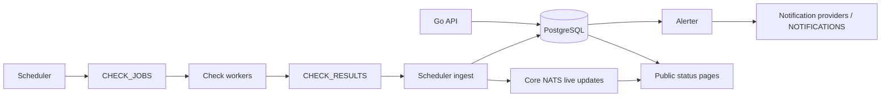

# Architecture

Probara is a Go monorepo with independently deployed API, scheduler, worker,
alerter, and public status-page services. PostgreSQL is the source of truth;
NATS JetStream transports durable work, while core NATS distributes live
updates. The authenticated Next.js application (`web/`) and static product
website (`website/`) are separate applications.

## Service responsibilities

| Component | Responsibilities | Data access |
|---|---|---|
| `api/` | Tenant-scoped monitor CRUD, sessions/OIDC/RBAC, API keys, imports, incidents, maintenance, SLA definitions and reports (live, issued, PDF/CSV), notification configuration, templates, locations, push and OTLP ingestion; the MCP endpoint and its OAuth authorization server (tools re-dispatched through the REST router) | PostgreSQL and NATS |
| `scheduler/` | Claim due monitors, publish check jobs, detect missing passive reports, schedule mesh probes, maintain rollups, retention, and soft-delete purging | PostgreSQL and NATS |
| `scheduler/internal/ingest/` | Persist results idempotently; advance location/quorum and monitor state; update timelines, metrics, and dirty rollup buckets; publish live changes | Runs in the scheduler process; PostgreSQL and NATS |
| `worker/` | Execute registered checkers and publish results; private workers report liveness and answer mesh probes | Check execution requires NATS, not PostgreSQL. Optional notification and AI consumers, and the AI triage relay, also use PostgreSQL (platform workers only) |
| `alerter/` | Derive group health; evaluate availability, latency anomalies, host metrics, TLS expiry, and mesh alerts; apply routing, escalation, maintenance, and dependency suppression | PostgreSQL, NATS, and synchronous notification providers when configured |
| `status-page/` | Render public pages, incidents, uptime, templates and live updates; manage browser push subscriptions and delivery | PostgreSQL reads and subscription/delivery writes; NATS |
| `ai-service/` | Local CPU inference (Python, FastAPI) for incident analysis, automatic alert triage and dependency suggestions: authenticated `/v1/decisions` returning probabilities over the closed choices in `shared/ai/catalogue.json`; bundled fine-tuned Laya head, offline | None: no PostgreSQL, NATS or egress. Called only by the API and the database-connected worker |
| `web/` | Authenticated operator UI and `/api` proxy, including cookies and SSE streams; the MCP OAuth consent screen and the root `/.well-known/` discovery proxy | Go API |
| `website/` | Statically exported public product website and documentation | No application database |

Worker checkers include HTTP, ping, DNS, TCP, gRPC, SIP (OPTIONS/REGISTER
probes and INVITE test calls, the one side-effecting checker), synthetic
API/browser, Redis, PostgreSQL, MongoDB, RabbitMQ, MySQL, and WebSocket checks.
A test call with `call.media` also sends UDP RTP and RTCP during its hold to
the address the far end's SDP answer chose, vetted by
`netguard.Policy.AllowsServerChosen`; its measurement rides inside the
result's `metrics_data`, so no message, ingest or schema contract changes. `agent`,
`push`, and `group` monitors are passive and are not dispatched as worker checks.

Host monitoring uses **probara-collector**, an OpenTelemetry Collector
distribution defined by the OCB manifest in `collector/`. Collectors send OTLP
metrics to the API at `/api/v1/otlp/v1/metrics`; there is no custom host-agent
implementation in this repository.

## Messaging contracts

The following are defaults; consult `shared/config/config.go` and the deployed
values for overrides.

| Purpose | Transport / stream | Subject |
|---|---|---|
| Scheduled checks | JetStream `CHECK_JOBS` | `check.jobs`, with location-specific subjects |
| Worker results | JetStream `CHECK_RESULTS` | `check.results`, with `.loc.<location-id>` variants |
| Alert events | JetStream `ALERTS` | `alerts.*` |
| Optional asynchronous notification delivery | JetStream `NOTIFICATIONS` | `alerts.dispatch.<plugin-type>` |
| Incident AI analysis (enabled by default) | JetStream `AI_RCA` | `ai.rca.jobs` |
| Automatic alert triage (worker-internal, never changes paging; 1 h max age, 30 min duplicate window, durable `ai-triage-workers`) | JetStream `AI_TRIAGE` | `ai.triage.jobs` |
| Status-page/live monitor updates | Core NATS | `statuspage.updates` |

The scheduler claims due monitors using transactions and `FOR UPDATE SKIP
LOCKED`, allowing multiple scheduler replicas. Result ingestion deduplicates
deliveries and preserves evidence ordering; late checks remain in history
without moving the current state backwards. See [state semantics](state-semantics.md)
for transition, quorum, freshness, and availability rules.

Check jobs are at-least-once: a delivery that is NAKed or outlives the
consumer's 30s AckWait is redelivered (3 deliveries at most). The worker calls
`InProgress` every 10s while a check and its publish run (bounded at the
check's timeout plus 30s), so a long check is not redelivered to a second
worker mid-run. Checks whose checker implements `SideEffectingChecker`
(`worker/internal/worker/checker.go`) for their config are at-most-once
instead: a redelivered job is acked without running or publishing
(`probara_worker_side_effect_redelivery_skipped_total{type}`), and a failed
result publish is retried in place (1s, 2s, 4s) and then dropped
(`probara_worker_side_effect_result_abandoned_total{type}`), never NAKed. A
lost sample reads as missing evidence; a repeated side effect cannot be undone.
A side-effecting check cut short by the worker's own shutdown (an INVITE test
call during a deploy) still tears its call down, then is acked and publishes
nothing (`CheckResult.Interrupted`,
`probara_worker_side_effect_result_interrupted_total{type}`): a gap, never a
recorded failure. On the dispatch side, every scheduled job carries a `Nats-Msg-Id` per
(monitor, location, due slot) (`checkJobMsgID`, `scheduler.go`): a dispatch
retried for the same slot (a lost PubAck, or a failed reschedule that rolls the
batch back) is absorbed by the stream's 2-minute duplicate window, so
side-effecting checks are at-most-once across redelivery and dispatch retries
alike. Run-now publishes without one: it is a deliberate manual trigger.

Private-location workers use location-scoped broker credentials and encrypted
monitor configurations. The platform validates location result provenance
before persistence. These workers do not receive the database connection or
the platform encryption key. See [worker authentication](location-worker-auth.md).

## Alert lifecycle and delivery

The alerter evaluates database state periodically. Availability outages have
one open alert per monitor and kind, enforced by a partial unique index.
Routing comes from monitor overrides or workspace defaults; maintenance,
group rollup, and dependency suppression determine which channels may fire.
Escalation delays and reminders are tracked per alert/channel.

Group state is derived from enabled, nondeleted leaf descendants in one
evaluation, including nested groups. No participating leaves means unknown.
An empty group's old availability alert is resolved; group timeline integration
remains a separate limitation documented in the state specification.

Notification claims are serialized in PostgreSQL. One-shot advisory events
(`acknowledged` to paging channels, `suspected_cause` to paged chat, email, SMS
and webhook channels) claim their own columns and never move reminder timing.
Failed recovery delivery
is retried from durable resolved-alert and channel-state records, including
after an alerter restart. Optional worker dispatch uses delayed retries and
an acknowledgement timeout longer than the delivery deadline. Delivery to
external providers is not an exactly-once transaction: a provider can accept
a message before a client timeout or process failure. Receivers should use
idempotency where supported. A channel that sends to several recipients one
by one (SMS) records each accepted recipient in
`alert_notification_recipient_deliveries` (migration 000097), outside the
claim, so a retry on any replica or worker reaches only the rest; the
dispatch envelope's `delivery_key` names the event (and reminder round) those
rows belong to.

## Storage and maintenance

Migrations live in `shared/db/migrations/`. The database stores tenants,
monitors, raw results, per-location state, state intervals, incidents, alert
delivery state, OTLP series/samples, and hourly/daily rollups.

Retention and rollup maintenance hold PostgreSQL session advisory locks on
dedicated connections, releasing the same session when a run ends. Retention
works in bounded batches; expired data remaining after a run keeps cleanup
eligible for subsequent passes. Backlog gauges expose affected tenant counts
and the oldest expired timestamp without scanning every expired row.

Analytics choose raw, rollup, or interval-based calculations according to
window coverage and the existing state semantics. Raw analytics stream
results into accumulators; exact median/P95 calculations retain latency
samples, so their memory still scales with the number of successful checks.
See [correctness notes](correctness-notes.md) for sampled/interval differences.

Interval availability has one implementation, `IntegrateTimeline` in
`shared/analytics/timeline.go`: the monitor headline and SLA reports both
reduce its per-state seconds, so a one-monitor SLA and that monitor's
headline agree. SLA reports are computed on request by the API from
`monitor_state_intervals`, `maintenance_windows` and `alerts`; issuing one
freezes the report document in `sla_reports` (see
[state semantics](state-semantics.md) S-U6/S-U7).

## Shared code and security boundaries

- `shared/monitorstate`, `shared/analytics`, and `shared/alertrouting` hold
  state, availability, and notification-routing contracts shared by services.
- `shared/queue` and `shared/statusupdates` separate durable work from live
  fan-out. Database persistence must not depend on a core-NATS subscriber.
- `shared/secrets`, `shared/locationauth`, and the notification plugin registry
  handle encrypted configuration and delivery integrations.
- API authorization is tenant-scoped and capability-aware. Read access does
  not grant worker credentials, push tokens, or permission to send saved
  monitor secrets to caller-selected destinations. See [auth and RBAC](auth-and-rbac.md).

## Deployment and verification

Docker Compose provides local PostgreSQL/NATS, the `local-ai` container and
optional service containers; `helm/monitoring-platform` defines Kubernetes
deployment assets. Use `make start-all-local` for local Go services, or
`make start-all` for the Docker-backed stack, with the corresponding
stop/restart commands.

Local AI is on by default in both. Compose runs `local-ai` on loopback port
8090 and wires the API and worker to it; the Make targets start it separately
so a failed image build never blocks the platform. Helm's `localAI` values
deploy one `Recreate` replica (1 CPU/2 GiB request, 4 CPU/4 GiB limit), a
ClusterIP Service and a NetworkPolicy admitting only the API and worker pods
with no egress, and render the `LOCAL_AI_*` client env into the API and
platform worker only; the alerter gets just the `LOCAL_AI_DISABLED` and
`AI_TRIAGE_ENABLED` kill switches.
`localAI.externalUrl` replaces the bundled service with an operator-run one;
`localAI.enabled=false` without it renders `LOCAL_AI_DISABLED=true`. The token
is the chart credential `local_ai_token`.

Operational endpoints `/healthz`, `/readyz`, and `/metrics` expose process
health, dependency readiness, and Prometheus metrics. Inspect scheduler
retention/rollup progress, consumer retries, worker freshness, and provider
delivery errors when diagnosing missing or delayed monitoring data.

Run `make test` and `make lint` for Go changes. Integration tests require a
working Docker provider for disposable PostgreSQL/NATS instances. For the
operator UI, run `npm test`, `npm run lint`, `npm run typecheck`, and
`npm run build` in `web/`; frontend CI runs these checks. Run the corresponding
lint/typecheck/build checks in `website/` when that application changes.

## Local AI analysis

The API prepares at most 50 dependency candidates from 30-day co-firing
history, service tags, groups and names. The internal authenticated service
returns probabilities over supplied closed choices. `shared/ai` validates
identity, probability sums and evidence support, rejects graph cycles and
renders measured explanations. Proposals are written only through the existing
authoritative dependency endpoint after an operator accepts them.

Incident requests reserve a pending row and publish the existing versioned
`AI_RCA` job. The platform worker gathers tenant-scoped evidence from 15 minutes
before the earliest linked alert (incident creation fallback) through 60 minutes
after it, capped at request time. Window summaries precede timeline sampling;
configured upstreams, linked dependency roots, overlapping maintenance,
allowlisted HTTP/TLS timings and fresh native host gauges contribute evidence.
Missing, expired, conflicting and truncated detail is explicit. Decisions are
batched by affected monitor and aggregated conservatively. Model output selects
hypotheses; maintained templates supply all prose and troubleshooting actions.
Unsupported evidence completes with abstention; a temporarily unavailable
service (`ai.ErrUnavailable`) is redelivered, and other service failures (or
an unavailable service on the final delivery) persist a failed run with a
retry action. PostgreSQL session locks serialize duplicate
jobs and tenant/incident/analysis IDs scope every persistence operation.
Platform result rows (S-E1) are never evidence, and linked mesh-edge alerts are
recorded as incomplete evidence rather than modeled.

Each delivery runs under one deadline (`LOCAL_AI_TIMEOUT_SECONDS` + 30s) with a
15s `InProgress` heartbeat; transient errors retry with a delay, and the final
delivery records a failure except on worker shutdown. DB-connected workers fail
pending analyses older than 20 minutes (longer than the unavailable-AI retry
window, so a job waiting out a retry delay is not failed), skipping rows locked
by an active run unless they are older than 30 minutes; this replaces the API
read-path timeout.
With no DB-connected worker running, pending analyses stay pending until one
returns. The consumer and the sweep restart with capped backoff, and the
consumer re-creates its durable if it disappears from the server. A publish
failure in the API records the run as failed immediately.

Inference runs in the installation-owned `ai-service` at `LOCAL_AI_URL`,
called with `LOCAL_AI_TOKEN` by the API (dependency suggestions, readiness)
and the database-connected platform worker (incident analysis, alert triage)
only; private-location workers, the scheduler and the alerter never call it.
It runs one batch at a time behind a bounded queue and answers 429 when
saturated, which the worker retries like any transient error. See
[local-ai.md](local-ai.md) for the artifact, build and release gate.
Installation disabling overrides preserved workspace switches; missing
workspace rows default enabled in both API and worker. Migration 000092 retains
legacy text/provider columns and labels historical analyses.

### Automatic alert triage

Triage never changes paging: it writes `alert_triage` (migration 000094) and
nothing else, and routing (`shared/alertrouting`), suppression, severity and
the created/reminder/acknowledged/resolved events never read it. The alerter
reads it in one place, the opt-in `dispatchSuspectedCauses` phase
(`ai_settings.triage_notifications_enabled`, migration 000095): one
`suspected_cause` follow-up per channel already paged and still routed, for a
ready triage naming a catalogue cause at medium or high confidence that no
operator corrected, sent through `deliverNotification` with a one-shot claim on
`alert_notification_states.suspected_cause_sent_at`. It is muted by the same
predicate as reminders, targets only plugins advertising `CapabilityFollowUp`
(not PagerDuty or Opsgenie), runs last in the tick on its own time budget so
the recovery sweep keeps its share, and stops under `LOCAL_AI_DISABLED=true` or
`AI_TRIAGE_ENABLED=false`. The alerter reads the catalogue only and never calls
local AI. On the API side, triage is read for display (`triageview`) and by
SLA reports, which roll monitor outages up by suspected cause
(`api/internal/services/slas/causes.go`, read-only through
`triageview.EffectiveCause`: an operator label wins over the model's
hypothesis; live reports recompute it, issued reports freeze it); neither
feeds paging. The SLA
"Triage pending" bucket and the relay's claim build eligibility from the same
`shared/ai` fragments (`TriageClaimableAlertSQL`, `TriageSettingsEnabledSQL`),
and the API reads `AI_TRIAGE_ENABLED`/`LOCAL_AI_DISABLED` so nothing reads as
pending while claims are switched off. Workspaces opt in through `ai_settings.auto_triage_enabled`
with a delay, a per-monitor cooldown and an hourly cap.

The relay (`worker/internal/airca/relay.go`) is a transactional outbox in each
DB-connected platform worker. Every 15 seconds it opens one transaction, takes
a transaction-scoped advisory lock (one tick across replicas, so the caps are
exact), claims open alerts (`active` or `acknowledged`) with
`INSERT … ON CONFLICT (alert_id) DO NOTHING`, re-arms queued rows that no
delivery has started, and fails stale pending rows. It publishes `TriageJob`
to `AI_TRIAGE` only after commit, with the triage ID as `Nats-Msg-Id`. An alert
is claimed once it has been open for the workspace delay, and at least two
monitor intervals (that part capped at 1 h), when it triggered within the last
6 h. Claims stay within the workspace's hourly cap (skipped rows excluded) and
a platform bound of 200 pending rows. A republish (at most twice, 3 min apart)
lands inside the stream's 30 min duplicate window, so it restores only a
publish that never reached the stream. Rows still pending 30 min after their
first delivery, or 70 min after the claim with no delivery, become `failed`.

The triage consumer has the same hardening as the `AI_RCA` consumer (shared in
`jobrun.go`): heartbeat, one delivery deadline, per-job session lock,
`RetryAfter`, final-delivery failure, lost-race detection and restart
supervision. It skips resolved alerts, monitors still in cooldown, mesh-edge
alerts and workspaces that turned triage off. Otherwise it builds
single-monitor evidence anchored at the alert's `triggered_at`, through the
same `buildEvidence` path as incident analysis (`context.go`), and runs the
same analyzer. Every write is guarded by tenant, alert and `status='pending'`.
A worker whose local AI client config was rejected at startup (no analyzer)
claims nothing in its relay ticks; RCA jobs on it fail as not configured
correctly. A local AI that is temporarily unavailable (`ai.ErrUnavailable`:
429/502/503/504, refused or reset connections) is NAKed for up to 3
deliveries (1 then 2 min, or its `Retry-After`, capped at 2 min) by both job
consumers; still unavailable on the final delivery, or any other model
failure, records `failed`. `AI_TRIAGE_ENABLED=false` or
`LOCAL_AI_DISABLED=true` stops claims, while queued rows drain as skipped.
